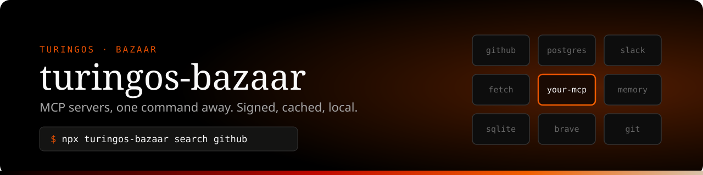

<p align="center">
  
</p>

<p align="center">
  <b>Part of <a href="https://github.com/uncoalesced/TuringOS">TuringOS</a></b>
  · <a href="https://uncoalesced.github.io/turingos-bazaar/">Web catalogue</a>
  · <a href="CONTRIBUTING.md">Contribute a server</a>
</p>

<p align="center">
  <a href="https://www.npmjs.com/package/turingos-bazaar"></a>
  <a href="https://github.com/uncoalesced/turingos-bazaar/actions"></a>
  <a href="LICENSE"></a>
</p>

# turingos-bazaar

An **MCP (Model Context Protocol) Bazaar**: a curated registry of MCP servers plus a
zero-dependency CLI and a browseable web catalogue. Install any server into Claude Code,
Cursor, Windsurf, Continue and Cline with one command.

This is the standalone home of the bazaar that ships inside
[TuringOS](https://github.com/uncoalesced/TuringOS). It works on its own, no TuringOS required.

## Quick start

```bash
# Run without installing
npx turingos-bazaar search github

# Or install globally
npm i -g turingos-bazaar
mcp-bazaar browse
```

## CLI

```bash
mcp-bazaar                      # browse (fzf-like list)
mcp-bazaar search <query>       # search registry
mcp-bazaar info <id>            # details for a server
mcp-bazaar install <id>         # install + register with detected clients
mcp-bazaar uninstall <id>       # remove from clients + local state
mcp-bazaar installed            # list installed servers
mcp-bazaar clients              # show detected MCP clients & config paths
mcp-bazaar export <id>          # print the MCP config snippet
mcp-bazaar validate             # validate registry.json (contributors)
```

Useful flags:

- `--client <name>` — target a single client (`claude-code`, `cursor`, `windsurf`, `continue`, `cline`).
- `--all-clients` — register with every detected client.
- `--yes` — accept prompts (useful in scripts/CI).
- `--dry-run` — print what would change without writing.

## Web catalogue

A static site lives in `web/` and is published to GitHub Pages:
https://uncoalesced.github.io/turingos-bazaar/

## Two catalogues

This repo carries two catalogues, for two readers:

| | Source | Read by |
|---|---|---|
| Registry | `registry/registry.json`, checked against `registry/schema.json` | the `mcp-bazaar` CLI and the web catalogue |
| Signed index | `entries/<type>/<id>.json`, checked against `schema/bazaar-entry.schema.json` | the TuringOS `turingos bazaar` command and `turingosd` |

The signed index is built by `scripts/build_index.sh` into `v1/index.json` and signed with
Ed25519 by `scripts/sign_index.sh` into `v1/index.json.sig`. GitHub Pages serves both at
`https://uncoalesced.github.io/turingos-bazaar/v1/`. TuringOS verifies the signature with
`keys/bazaar.pub` and refuses an index that does not verify. The private key never lives in
this repo; CI reads it from the `BAZAAR_SIGNING_KEY` secret.

After you change anything under `entries/`, rebuild and sign before you commit, or Pages
will publish a stale index:

```bash
./scripts/build_index.sh
./scripts/sign_index.sh
```

Entries may carry `requires.turingos`, the lowest TuringOS version that supports them.
Every entry currently asks for `1.3`.

Contributions are welcome. See [CONTRIBUTING.md](CONTRIBUTING.md).

## How install works

1. Looks up the server in the registry.
2. Checks required environment variables (prompts if missing).
3. For `npx`/`pip`/`cargo` runtimes, verifies the toolchain; for `git`, clones and builds.
4. Writes an entry under `mcpServers.<id>` in each target client's config file (atomic, mode 600).
5. Records install state in `~/.mcp-bazaar/installed.json`.

Nothing is sent anywhere; everything is local.

## License

MIT
